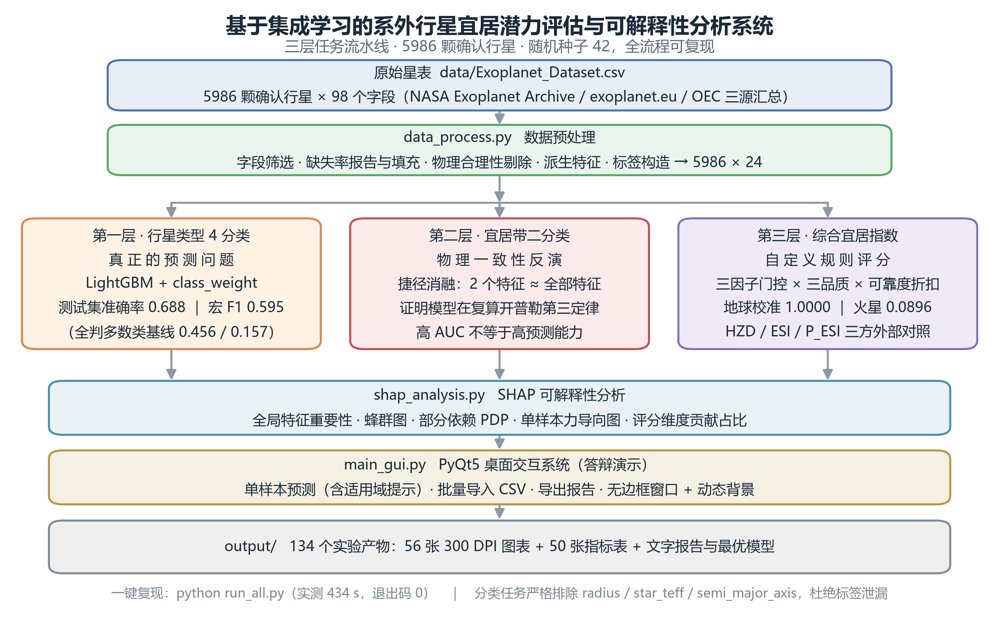
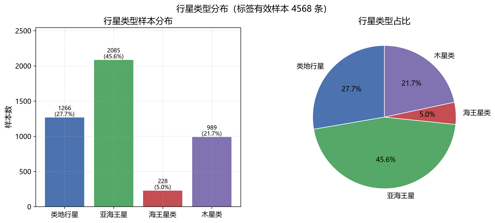
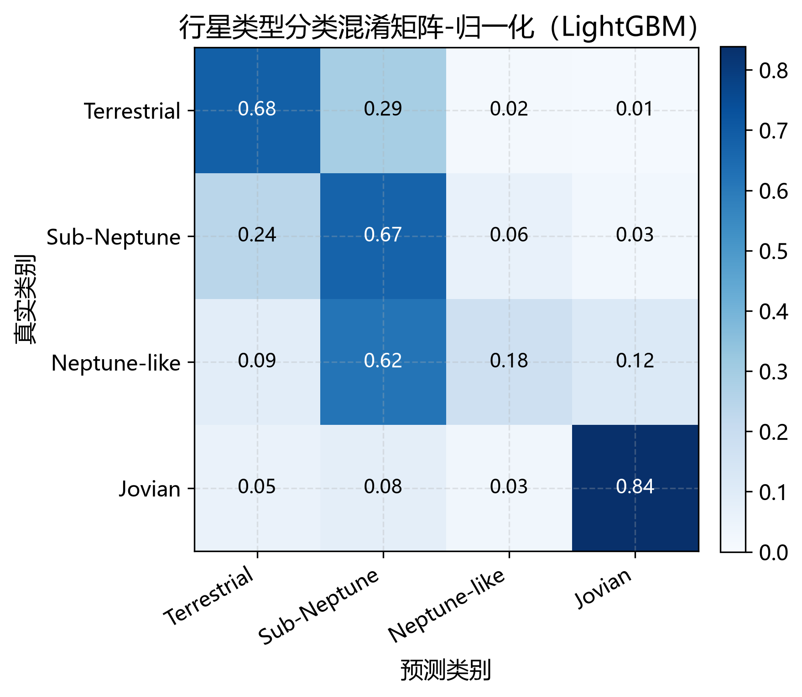
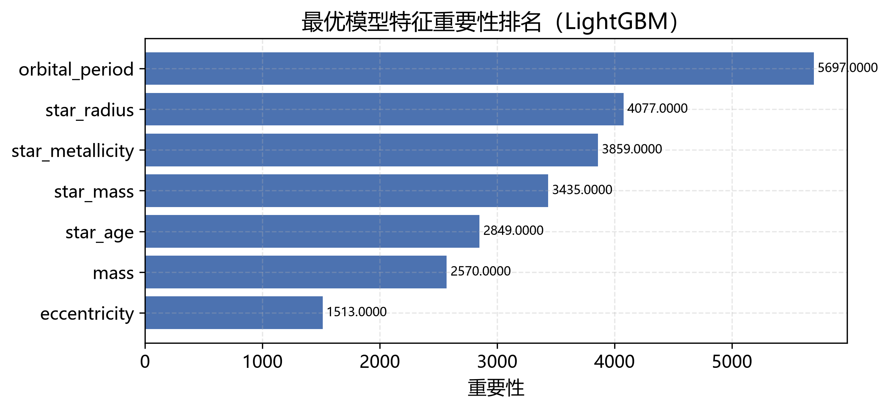
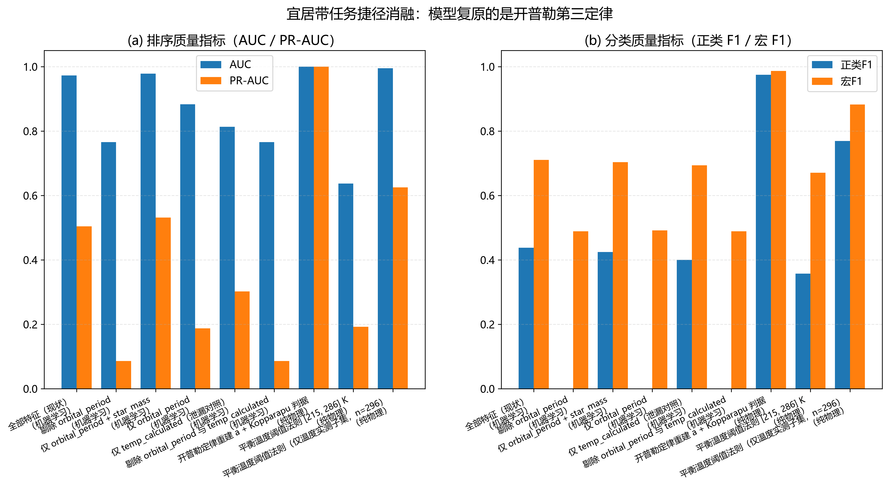
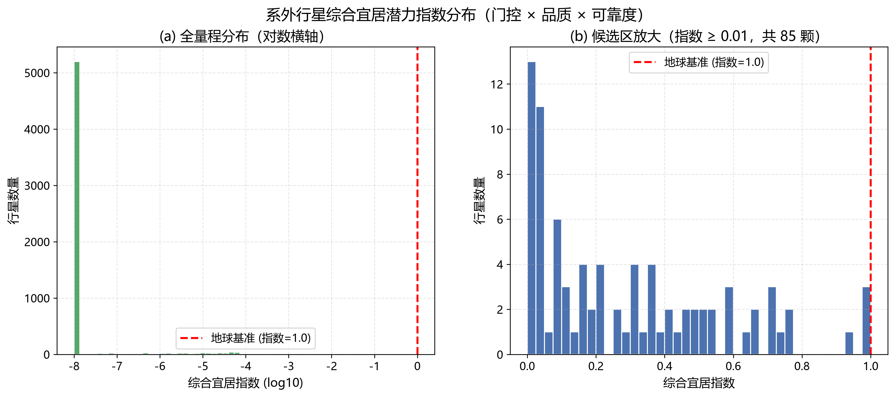
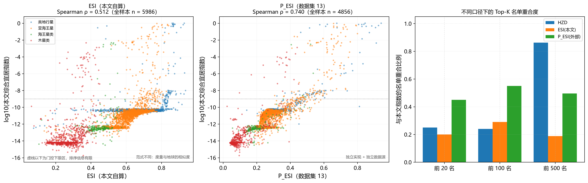
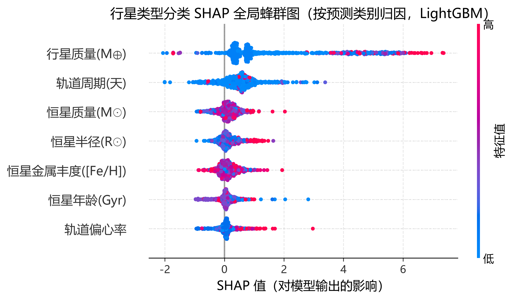
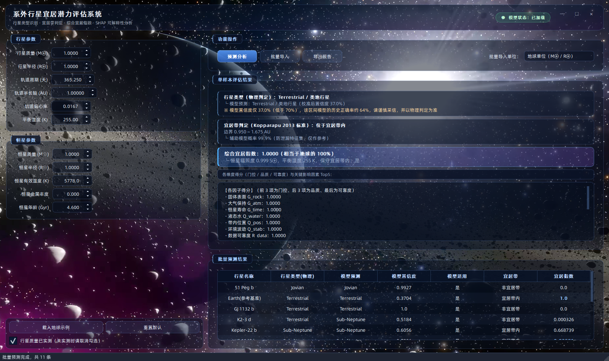

<div align="center">

# 基于集成学习的系外行星宜居潜力评估与可解释性分析系统

**Exoplanet Habitability Assessment &amp; Interpretability System**

本科毕业设计项目　·　三层任务流水线 + SHAP 可解释性 + PyQt5 桌面交互系统


`5986 颗确认行星`　`98 个原始字段`　`134 个实验产物`　`56 张 300 DPI 图表`　`随机种子 42`

</div>

---

## 一句话概括

> 在观测数据不完备、且部分判定标准本身就能被物理公式严格给出的条件下，
> 研究集成学习**能不能**、以及**在什么意义上**被用于系外行星宜居性评估——
> 并对那些「看起来很高」的指标做反向检验。

这个项目最大的特点不是把准确率刷高，而是**对每一个高分都追问一次「它是真的吗」**：
宜居带任务 AUC 高达 0.97，消融实验却证明只要 2 个特征就能复现，
也就是说模型其实在重算开普勒第三定律——于是这一章被重新定位成
「物理一致性反演」而不是「预测」；自定义的宜居指数没有客观真值，
就改用**地球基准标定 + 太阳系七体校验 + 权重扰动 + 三方外部指标对照**
来证明它不是拍脑袋。

---

## 目录

- [系统架构](#系统架构)
- [数据](#数据)
- [第一层 · 行星类型 4 分类](#第一层--行星类型-4-分类)
- [第二层 · 宜居带判定（一个负面结果）](#第二层--宜居带判定一个负面结果)
- [第三层 · 综合宜居指数](#第三层--综合宜居指数)
- [SHAP 可解释性分析](#shap-可解释性分析)
- [PyQt5 桌面交互系统](#pyqt5-桌面交互系统)
- [工程实践](#工程实践)
- [如何复现](#如何复现)
- [已知局限](#已知局限)
- [引用与开源说明](#引用与开源说明)

---

## 系统架构



三层任务的**性质完全不同**，项目对它们的处理方式也不同：

| 层 | 任务 | 任务性质 | 模型特征数 | 代表指标 |
| --- | --- | --- | :---: | --- |
| 第一层 | 行星类型 4 分类 | **真正的预测问题**（标注只依赖半径，其余物理量与之仅有统计关联） | 7 | 准确率 0.688 ｜ 宏 F1 0.595 |
| 第二层 | 宜居带二分类 | **物理一致性反演**（标签可由公式精确算出） | 6 | AUC 0.973，但 2 特征即可复现 |
| 第三层 | 综合宜居指数 | **自定义规则评分**（无客观真值，靠外部验证） | 7 个物理字段 | 地球校准 1.0000 ｜ 火星 0.0896 |

---

## 数据

**来源**：NASA Exoplanet Archive（Planetary Systems + Composite Parameters）、
exoplanet.eu 与 Open Exoplanet Catalogue 三源汇总表。

| 项目 | 数值 |
| --- | --- |
| 原始规模 | **5986 行 × 98 列**，`planet_status` 全为 `Confirmed` |
| 探测方式分布 | Primary Transit 4462 ｜ Radial Velocity 1034 ｜ Microlensing 252 ｜ RV+Astrometry 54 ｜ Timing 50 |
| 预处理后 | **5986 行 × 24 列**（字段筛选 / 缺失率报告 / 物理合理性剔除 / 派生特征 / 标签构造） |
| 派生特征 | 行星密度、恒星辐照通量、轨道稳定性指标 |
| 质量缺失率 | 原始 65.2%，合并 `mass_sini`（径向速度 m·sin i 下限）后降至 **48.9%** |



### 防标签泄漏：把「不许进模型」写成代码约束

这是全项目最核心的工程纪律——**用来构造标签的字段，以及刻画「人类怎么观测到它」
的观测史字段，绝不允许进入模型特征矩阵**：

```python
# config.py —— 每条黑名单都写明了物理理由，而不是随手删列

# 7.6 【硬性约束】防止标签泄漏的特征黑名单
#     行星类型 4 分类：标签由 radius 构造，且 semi_major_axis / star_teff 与
#     radius 存在强物理关联；衍生特征 density(含 radius)、stellar_flux
#     (含 star_teff 与 semi_major_axis) 同样泄漏，必须一并排除。
CLASSIFICATION_FEATURE_BLACKLIST = [
    "radius", "star_teff", "semi_major_axis", "density", "stellar_flux",
    "temp_calculated",
]

#     宜居带二分类：标签由 semi_major_axis、star_teff、star_radius 三者共同
#     构造（Kopparapu 边界需要恒星光度 L = 4·pi·R^2·sigma·T^4，边界距离
#     d = sqrt(L/Seff)），三列都是标签函数的自变量而非普通特征。
HZ_FEATURE_BLACKLIST = [
    "semi_major_axis", "star_teff", "star_radius", "radius",
    "density", "stellar_flux", "temp_calculated",
]

# 观测偏差字段：刻画「人类何时、用何种手段观测到它」，而不是行星自身的物理属性。
OBSERVATIONAL_FIELDS = ["detection_type", "detection_type_encoded", "discovered",
                        "star_distance"]
```

**每一条都有实测理由，不是拍脑袋定的**：

| 字段 | 为什么必须排除 | 实测证据 |
| --- | --- | --- |
| `radius` / `star_teff` / `semi_major_axis` | 直接或间接参与标签构造 | 见上表黑名单 |
| `star_radius` | Kopparapu 边界公式中恒星光度的自变量 | 固定 Teff = 5780 K 时，0.5 / 1.0 / 2.0 R☉ 对应内边界 0.475 / 0.950 / 1.901 AU，近似线性 |
| `temp_calculated` | `Teq = Teff·sqrt(R*/2a)·(1-A)^0.25`，自变量恰是上面三列 | 分类任务中缺失率 66.9%，填充后 66.9% 的样本取同一常数 833 K——模型实际读到的是「温度有没有被测到」 |
| `star_distance` | 离我们越近的系统观测越充分，会以探测选择偏差「预测」标签 | 曾排到特征重要性**第 1**，高于 `orbital_period` |
| `inclination` | 纯观测几何量，样本集中在 78°~90°（只有近乎侧视才会被探测到） | 中位数 86.4°，填充后 54% 取同一常数 88.45°；移除后 5×3 折准确率 0.6871 → 0.6837（差值小于折间标准差） |
| `detection_type` / `discovered` | 观测史记录，与行星是否宜居没有因果关系 | 已从 `processed_data.csv` 中整体移除 |

> **一段值得说的排查经历**：`star_distance` 最初是当「恒星环境属性」保留的，
> 直到特征重要性排名显示它**排第 1**——一个「我们离它多远」的观测几何量，
> 却比轨道周期更能预测行星类型。这显然不是物理，而是探测选择偏差。
> 顺着这条线索又查出 `inclination` 的同类问题，一并清除。
> 整个过程记录在项目的特征泄漏审计报告里。

---

## 第一层 · 行星类型 4 分类

### 标签定义（R⊕ = 1）

| 类型 | 半径区间 |
| --- | --- |
| 类地行星 Terrestrial | `radius < 1.7` |
| 亚海王星 Sub-Neptune | `1.7 ≤ radius < 3.9` |
| 海王星类 Neptune-like | `3.9 ≤ radius < 6.0` |
| 木星类 Jovian | `radius ≥ 6.0` |

### 实验设计

- 数据划分：70% 训练 / 15% 验证 / 15% 测试，分层抽样；
- 4 个模型对比：逻辑回归、随机森林、XGBoost、LightGBM；
- 两组对照：**对照组** `class_weight='balanced'`　vs　**实验组** SMOTE 过采样
  （SMOTE 置于交叉验证的**折内**，避免合成样本在折间渗漏）；
- 模型选择准则：**验证集宏 F1**（而非 AUC 或准确率）——海王星类只占 5%，
  单看准确率会奖励「躺平判多数类」的模型。

### 结果（测试集 686 条）

| 组别 | 模型 | 准确率 | 加权 F1 | 宏 F1 |
| --- | --- | :---: | :---: | :---: |
| 对照组 | 逻辑回归 | 0.4155 | 0.4413 | 0.4049 |
| 对照组 | 随机森林 | 0.6953 | 0.6942 | 0.5960 |
| 对照组 | XGBoost | 0.6560 | 0.6731 | 0.5918 |
| **对照组** | **LightGBM（最优）** | **0.6880** | **0.6895** | **0.5950** |
| 实验组 | 逻辑回归 | 0.4096 | 0.4264 | 0.3935 |
| 实验组 | 随机森林 | 0.6778 | 0.6850 | 0.5978 |
| 实验组 | XGBoost | 0.6924 | 0.6994 | 0.6037 |
| 实验组 | LightGBM | 0.6953 | 0.6987 | 0.6180 |

**参照基线**（全判多数类 Sub-Neptune）：准确率 0.4563、宏 F1 0.1567。
所以 0.688 / 0.595 是有实质增益的，而不是「看起来还行」。

### 最优模型逐类表现

| 类型 | 精确率 | 召回率 | F1 | 测试样本数 |
| --- | :---: | :---: | :---: | :---: |
| 类地行星 | 0.60 | 0.68 | 0.64 | 190 |
| 亚海王星 | 0.71 | 0.67 | 0.69 | 313 |
| 海王星类 | 0.19 | 0.18 | 0.18 | 34 |
| 木星类 | 0.90 | 0.84 | 0.87 | 149 |





### 5×3 折重复交叉验证（n = 4568，每折 913）

| 口径 | 准确率 | 宏 F1 | 海王星类 F1 |
| --- | :---: | :---: | :---: |
| 全体样本 + 主模型 | 0.6785 ± 0.0148 | 0.5806 ± 0.0128 | 0.1571 ± 0.0458 |
| 全体样本 + 专家复核（级联） | 0.6740 ± 0.0165 | 0.5815 ± 0.0163 | 0.1673 ± 0.0563 |
| **适用域内 + 主模型** | **0.8138 ± 0.0160** | **0.6642 ± 0.0263** | 0.2475 ± 0.0793 |
| 适用域内 + 专家复核 | 0.8012 ± 0.0268 | 0.6541 ± 0.0242 | 0.2426 ± 0.1045 |

「适用域内」指质量已实测的样本：在仪器真正测过质量的子集上，准确率从
0.679 提到 **0.814**。这个差距本身就是探测选择偏差的定量证据。

### 海王星类为什么难识别

海王星类只占 5%，更关键的是它的半径区间 `[3.9, 6.0]` 宽度**小于该类行星的
半径重建误差**——很多样本的观测半径本身就有 ±1 R⊕ 量级的不确定性，
于是标签边界处天然重叠。项目对此做了专项分析（学习曲线外推、
过采样比例扫描、质量实测子集对照），结论是**这是数据的信息上限，
不是模型欠拟合**（详见 `neptune_error_report.txt` 一类的诊断产物）。

---

## 第二层 · 宜居带判定（一个负面结果）

### 标签构造

用 Kopparapu (2013) 的保守宜居带模型，由恒星有效温度算出内 / 外边界（AU），
再与行星半长轴比较：`1 = 位于恒星宜居带内`，`0 = 不在`。

### 捷径消融：把模型拆开看它到底学了什么



同一划分、固定超参（XGBoost）下逐步增减特征：

| 类型 | 特征方案 | 特征数 | AUC | PR-AUC |
| --- | --- | :---: | :---: | :---: |
| 机器学习 | 全部特征（现状） | 6 | 0.9725 | 0.5041 |
| 机器学习 | **仅 `orbital_period` + `star_mass`** | **2** | **0.9781** | **0.5316** |
| 机器学习 | 仅 `orbital_period` | 1 | 0.8832 | 0.1870 |
| 机器学习 | 剔除 `orbital_period` | 5 | 0.7653 | 0.0859 |
| 机器学习 | 仅 `temp_calculated`（泄漏对照） | 1 | 0.8128 | 0.3021 |
| 纯物理 | **开普勒定律重建 a + Kopparapu 判据** | 4 | **1.0000** | **1.0000** |

**结论**：两个特征（轨道周期 + 恒星质量）经开普勒第三定律 `a³ = GM·T²/4π²`
就足以定出半长轴，判别力甚至**超过**完整的 6 特征模型；
纯物理规则的一致率达到 **0.9982**。

因此这一层不是「机器学习预测得多准」，而是一次**方法论贡献**：

> 当标签可以由已知物理定律精确给出时，机器学习任务会退化成
> 「重新发现这条定律」。报告一个漂亮的 AUC 而不做消融，等于把
> 「物理关系可复原」误报成「模型有预测能力」。

附带价值是反过来的：数据集中相当比例的样本缺失轨道半长轴，
模型与开普勒定律可以在这批样本上**互为补全与交叉校验**。

---

## 第三层 · 综合宜居指数

### 评分结构

没有采用 ESI / PHI 这类「与地球的相似度」范式（它有个明显缺陷：
越像地球就越宜居的单调假设并不成立），而是自建了一套
**门控 × 品质 × 折扣** 的评分：

```
总分 = (G_rock · G_atm · G_time)^α  ×  (Q_water^w1 · Q_pos^w2 · Q_stab^w3)^β  ×  R_data
       └────────── 门控（必要条件）──────────┘   └──────── 品质（连续量）────────┘   └ 数据可靠度 ┘
```

- **门控**：固体表面、大气保持能力、主序寿命——不满足则一票否决，
  所以木星类拿不到高分（`G_rock = 0.01`），而不是像相似度范式那样
  因为「质量差得远」被线性扣分；
- **品质**：液态水、宜居带内位置、环境波动；
- **折扣**：数据可靠度，对关键字段为估计值的样本降权。

### 地球基准校验（硬性要求）

评分输入地球参数后必须回到 **1.0 ± 0.02**，且是**逐维度**校验而非只看总分：

| 天体 | 质量 (M⊕) | 半径 (R⊕) | 半长轴 (AU) | 宜居指数 |
| --- | :---: | :---: | :---: | :---: |
| 水星 | 0.055 | 0.383 | 0.387 | 1.08e-11 |
| 金星 | 0.815 | 0.949 | 0.723 | 3.87e-05 |
| **地球** | **1.000** | **1.000** | **1.000** | **1.0000** ✅ |
| 火星 | 0.107 | 0.532 | 1.524 | 0.0896 |
| 木星 | 317.8 | 11.209 | 5.204 | 2.66e-08 |
| 土星 | 95.16 | 9.450 | 9.583 | 1.51e-09 |
| 海王星 | 17.15 | 3.880 | 30.07 | 3.09e-10 |



### 稳健性检验

| 检验 | 结果 |
| --- | --- |
| 权重 ±30% 扰动下的 Top20 重合率 | 0.977（最小值 0.950） |
| 六因子同时给满分的样本 | 仅 2 / 1126（说明评分有区分度，不是「都给高分」） |
| 目标集合富集倍数（类地且位于保守宜居带内） | **56.3 倍** |
| 大气情景扫描（保守 / 中等 / 乐观温室） | 三档情景下地球校准均为 1.0000，7 颗候选名单保持不变 |

### 与外部独立指标的一致性对照

自建评分必须能被外部检验，否则无法辩护。这里选了三套**不是本项目构造的**度量：

| 对照指标 | 全样本 n | Spearman（全样本） | 高分区 n | Spearman（高分区） | 前 100 重合 |
| --- | :---: | :---: | :---: | :---: | :---: |
| HZD（宜居带归一化距离，同思路对照） | 5986 | 0.5103 | 983 | **0.7887** | 24 |
| ESI（地球相似指数，不同范式） | 5986 | 0.5119 | 983 | 0.1971 | 29 |
| **P_ESI（第三方实现 + 第三方数据源）** | 4856 | **0.7401** | 571 | 0.2455 | 55 |



读数要点：与第三方独立实现的 **P_ESI ρ = 0.740** 说明排序不是自说自话；
而高分区与相似度范式（ESI）分歧明显（ρ = 0.197），正是本评分体系
**刻意设计**的结果——用带通型门控替代单调相似度。

### 规则化候选体（7 颗）

三项门控 ≥ 0.5、液态水品质 ≥ 0.5 且位于保守宜居带内：

`TOI-700 d`　`TRAPPIST-1 e`　`TRAPPIST-1 f`　`LHS 1140 b`　
`Kepler-22 b`　`TRAPPIST-1 g`　`TOI-2257 b`

采用**规则化口径**而不是「指数 ≥ 某阈值」：阈值会随评分口径漂移、
写进论文难以辩护，而规则化口径可以和物理判据逐条对照接受审查。

---

## SHAP 可解释性分析

对第一层最优模型与第三层评分分别做解释，产出全局重要性、蜂群图、
部分依赖图（PDP）、单样本力导向图，以及评分各维度贡献占比。



蜂群图给出的物理图景与领域直觉一致：**轨道周期**与**恒星质量**共同锚定
行星的空间位置，**恒星金属丰度 / 年龄**刻画宿主环境，**行星质量**则区分
气态巨行星与岩质行星。

---

## PyQt5 桌面交互系统



- **单样本预测**：输入质量、半径、轨道周期、偏心率、恒星质量与温度，
  输出行星类型 + 置信度、宜居带判定、综合宜居指数（与地球对比）、关键影响因素 Top5；
- **批量导入**：读入 CSV 批量预测，自动识别地球 / 木星单位；
- **导出报告**：结果一键存为 CSV；
- **适用域提示**：当输入落在训练分布之外时给出明确警告，而不是硬给一个数；
- **演示级界面**：无边框窗口（放大即整屏铺满）、动态背景视频、开屏动画。

---

## 工程实践

| 实践 | 说明 |
| --- | --- |
| **一键复现** | `python run_all.py` 依次跑完预处理 → 三层实验 → SHAP，实测 **434 s**、退出码 0，134 个产物全部自动落盘 |
| **图表规格** | 全部 300 DPI，中文显示自动配置回退字体链，可直接进论文 |
| **可复现性** | 全局随机种子 42，所有划分 / 采样 / 训练可复现 |
| **折内重采样** | SMOTE 只在训练折内做，避免合成样本渗漏到验证 |
| **自实现 Spearman** | 不依赖 scipy 的相关性实现，含并列秩的平均秩处理，避免版本差异导致复现失败 |
| **逐维度基准校验** | 地球校验不只看总分，每个子因子单独断言，防止「错误互相抵消后总分恰好为 1」 |
| **跨线程图像安全** | GUI 背景视频解码线程对 `QImage` 显式 `.copy()`，规避 Qt 隐式共享导致的野指针崩溃 |

---

## 如何复现

```bash
# 1. 环境
pip install -r requirements.txt

# 2. 一键跑完全部实验（约 7 分钟）
python run_all.py

# 3. 启动桌面系统
python main_gui.py
```

---

## 已知局限

这个项目把局限写在明面上，因为**说清楚边界比多报一个指标更有价值**：

1. **质量缺失偏差**：原始 `mass` 缺失率 65%，填充后该列约三分之二样本取同一常数，
   等价于嵌入了一个「质量是否实测」的标志位。实测表明仅用 4 个
   「是否实测」标志位、完全不看任何物理量，就能拿到 0.4038 的准确率
   （宏 F1 0.3411）——探测选择偏差是真实存在的。
2. **第二层不是独立预测任务**：它是物理一致性反演，已在消融实验中量化。
3. **海王星类识别上限受限**：类别占比仅 5%，且半径区间宽度小于半径重建误差。
4. **组泄漏**：同一恒星系统的行星可能同时落入训练与测试。实测按恒星系统分组划分后，准确率变化 1.12 个百分点、宏 F1 变化 0.27 个百分点，均小于折间标准差。
5. **第三层是「轨道—恒星尺度的宜居潜力上界」**：大气成分与压强、恒星 XUV 活动史、
   行星磁场、内部热流、海洋覆盖度等关键量在当前星表中并不存在，
   因此分数**不能**解读为「该行星确实宜居」。
6. **宜居性没有客观真值**：人类已知的宜居行星样本量为 1。
   第三层的所有检验都是**合理性 / 一致性检验**，不构成精度验证。

---

## 引用与开源说明

**代码**：本仓库为项目的**展示页**，仅包含说明文档与结果图。
完整源代码（15 个模块、约 14,500 行 Python）将在**毕业论文答辩结束后**开源，
届时会在此处更新链接。在此之前如需交流，欢迎通过 Issue 联系。

**数据来源与许可**（与代码许可分开，请分别遵守）：

| 来源 | 许可 |
| --- | --- |
| NASA Exoplanet Archive | Public Domain（NASA 数据政策） |
| exoplanet.eu | CC-BY-4.0（需署名） |
| Open Exoplanet Catalogue | CC-BY-SA-4.0 |

**主要方法参考**：

- Kopparapu et al. (2013), *Habitable Zones Around Main-Sequence Stars*, ApJ 765, 131
- Schulze-Makuch et al. (2011), *A Two-Tiered Approach to Assessing the Habitability of Exoplanets*, Astrobiology 11(10)
- Chen & Kipping (2017), *Probabilistic Forecasting of the Masses and Radii of Other Worlds*, ApJ 834, 17
- Lundberg & Lee (2017), *A Unified Approach to Interpreting Model Predictions* (SHAP), NeurIPS

---

<div align="center">

代码许可：[MIT](LICENSE)　·　数据许可：见上表

</div>